

**US English** | [RU Русский](README.ru.md)

# The Rift Division

**The Rift Division [TRD]** is a technical mod for Minecraft 1.21.1 (NeoForge).

⚠️ **Project Status:** Early development (Pre-Alpha). The current version features experimental mechanics and placeholders. Many features may be unstable or missing. At this time, our mod is **NOT** published on public platforms such as CurseForge and Modrinth due to the project status.

---

## Project Concept

Our mod combines two key mechanics: technical progression and dangerous expeditions into a new dimension. Early game stages are pure industrialization - players develop their technologies, build bases, and explore the world. But closer to the start of mid-game (middle of progression), the player will have enough resources to begin geological research of the depths. Soon they will discover that the world below bedrock (below Y-level -64) is divided into **4 layers of Necrosis**. Each layer is a unique ecosystem combining valuable resources and dangerous inhabitants who are not very fond of guests.

Necrosis is of high interest to the player as a place concentrating many useful minerals, various biological materials, and oil with a unique composition that seems to be begging for a couple of democratic expeditions =) But there is one catch - resources are presented in the form of massive deposits, mining which can take in-game days. It will require assembling special drills: modular drilling rigs with interchangeable heads, frames, and auxiliary modules. The player will have to set up camp and build fortifications around their drilling site to protect it from attacks. What a blessing that our mod kindly features various turrets and weapons that will make defense easier.

## Dependencies

**Requires:** Minecraft 1.21.1 with NeoForge `21.1.244`

The mod requires the following libraries:

* **GeckoLib** `4.9.3` (1.21.1 NeoForge) - animations for creatures, armor, and tools.
* **TerraBlender** `1.21.1-4.1.0.8` - biome generation.

**GeckoLib is planned to be RIPPED OUT COMPLETELY and replaced with our HEX Render in the near future, with a subsequent remake of all assets that used it!**

**HEX recommends:**
* **JEI (Just Enough Items)** `19.21.0.247` - for displaying recipes.

**Bundled with the mod (no separate download):**
* **Flywheel** `1.0.6-44`
* **HexRender** `2.0.0`

---

## Our Contacts:

*   **Discord:** *https://discord.gg/fnRfYfry7F*

---

## Gallery

p.s. this shows far from all of our project's content, it's just that SOMEONE was a tiny bit lazy.. no one's gonna look at our GitHub anyway, right?

<table>
  <tr>
    <td align="center"><a href="media/8.png">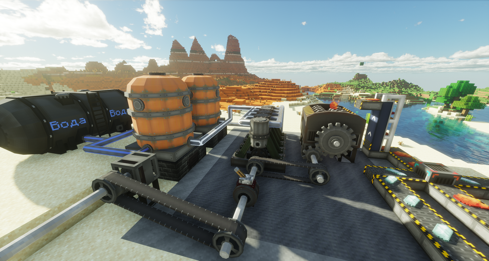</a></td>
    <td align="center"><a href="media/17.png">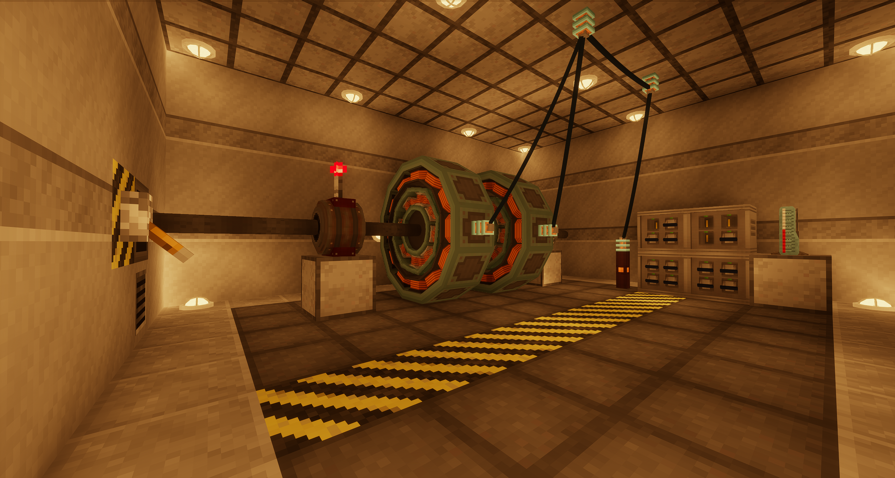</a></td>
  </tr>
  <tr>
    <td align="center"><a href="media/1.png">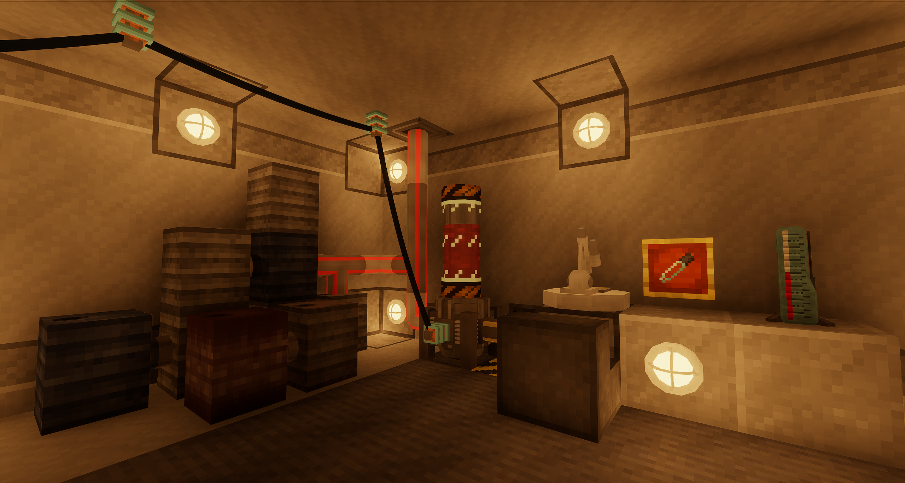</a></td>
    <td align="center"><a href="media/2.png">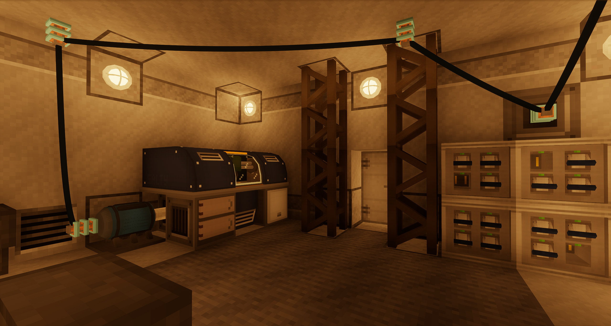</a></td>
  </tr>
  <tr>
    <td align="center"><a href="media/13.png">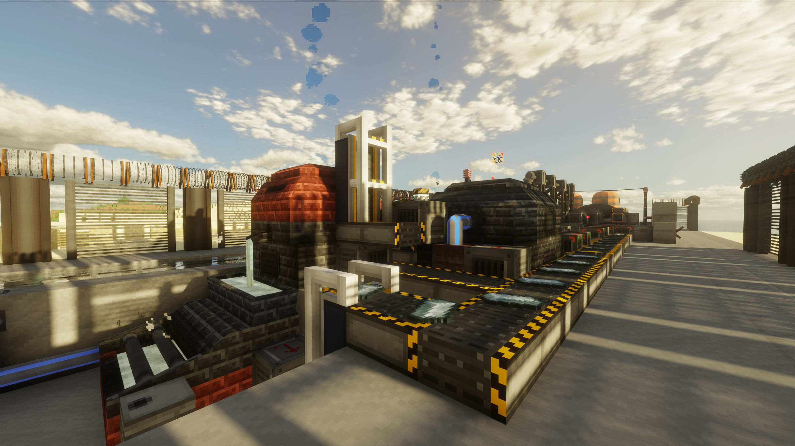</a></td>
    <td align="center"><a href="media/14.png">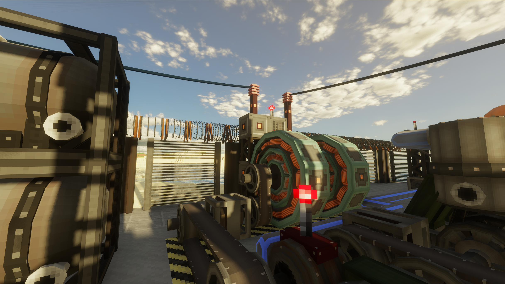</a></td>
  </tr>
  <tr>
    <td align="center"><a href="media/15.png">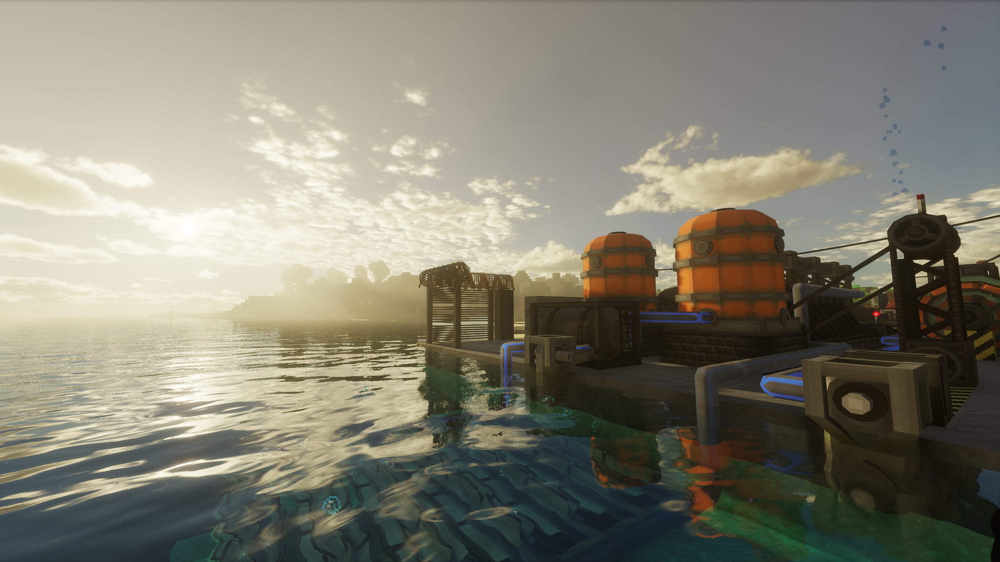</a></td>
    <td align="center"><a href="media/18.png">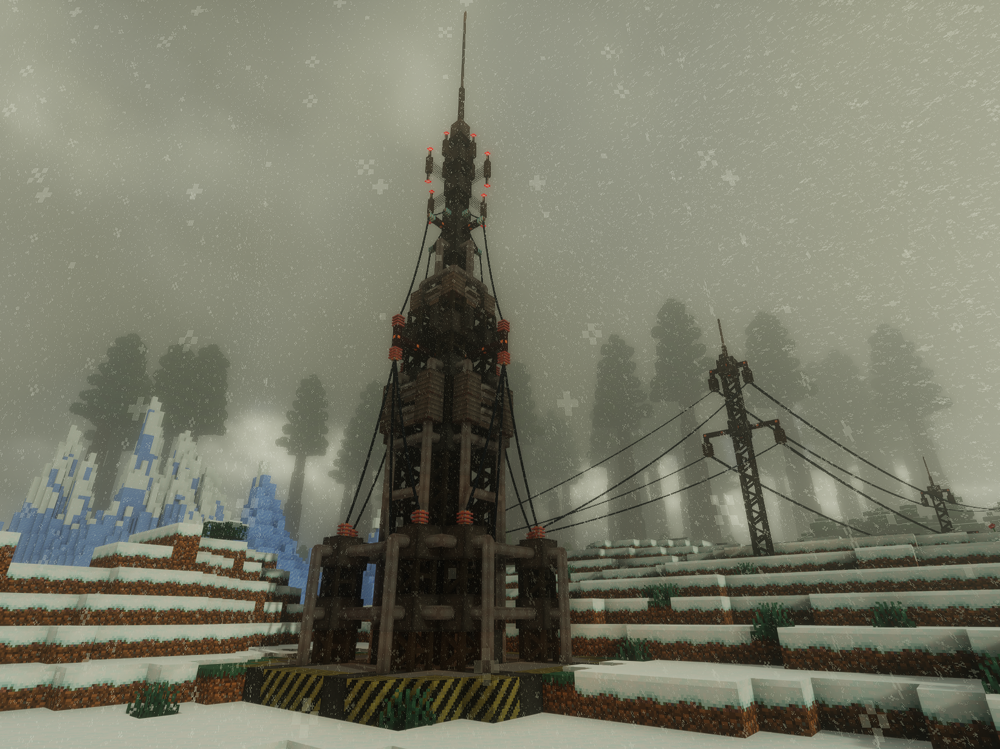</a></td>
  </tr>
  <tr>
    <td align="center"><a href="media/19.png">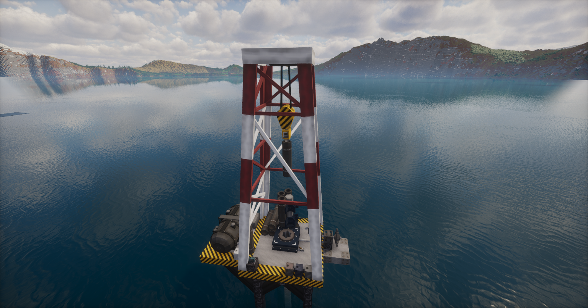</a></td>
    <td align="center"><a href="media/20.png">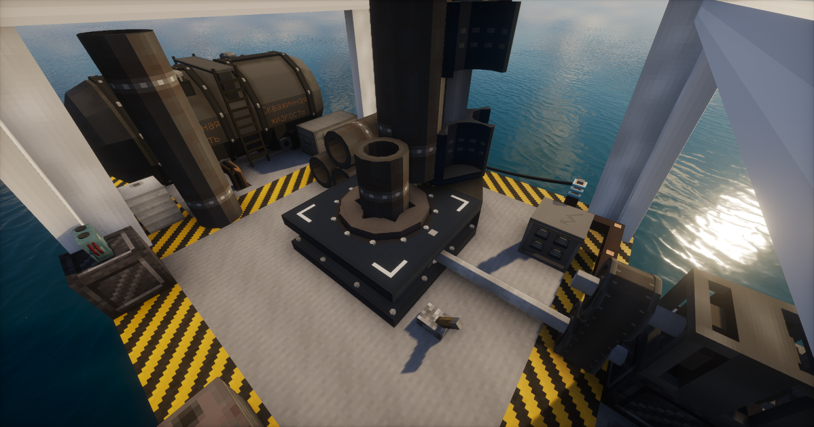</a></td>
  </tr>
  <tr>
    <td align="center"><a href="media/21.png">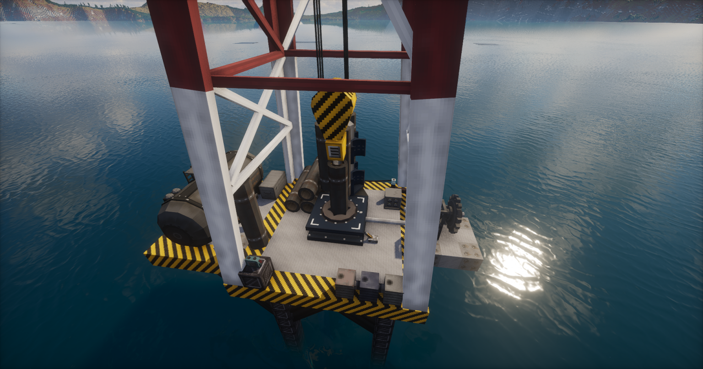</a></td>
    <td align="center"><a href="media/22.png">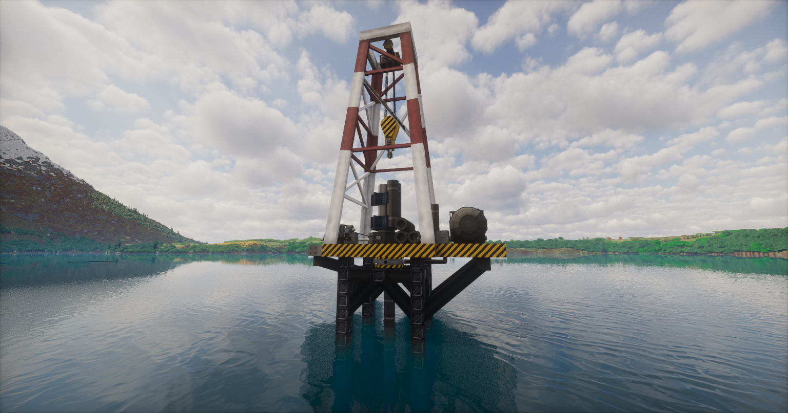</a></td>
  </tr>
</table>
