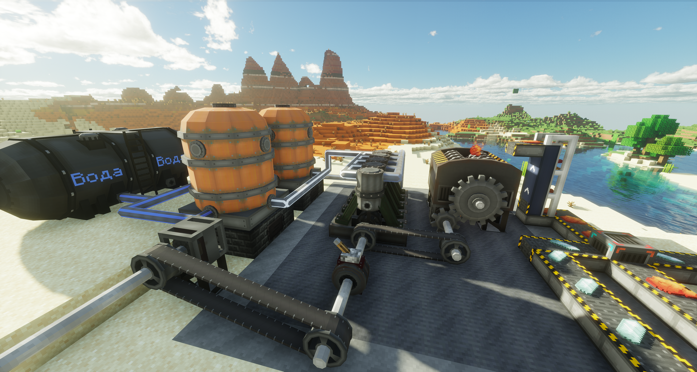
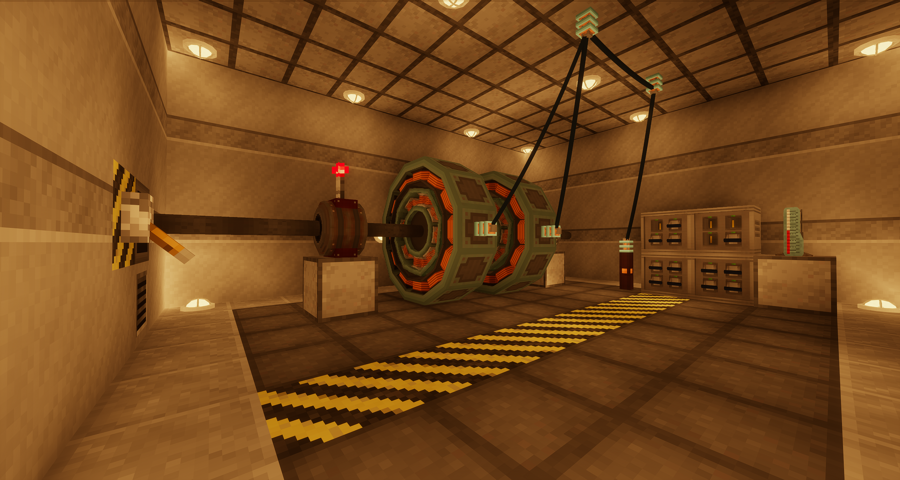
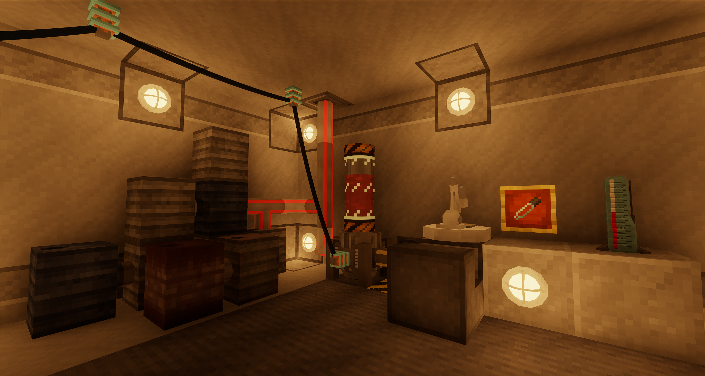
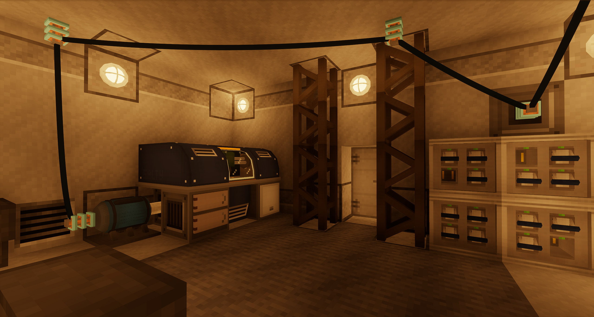
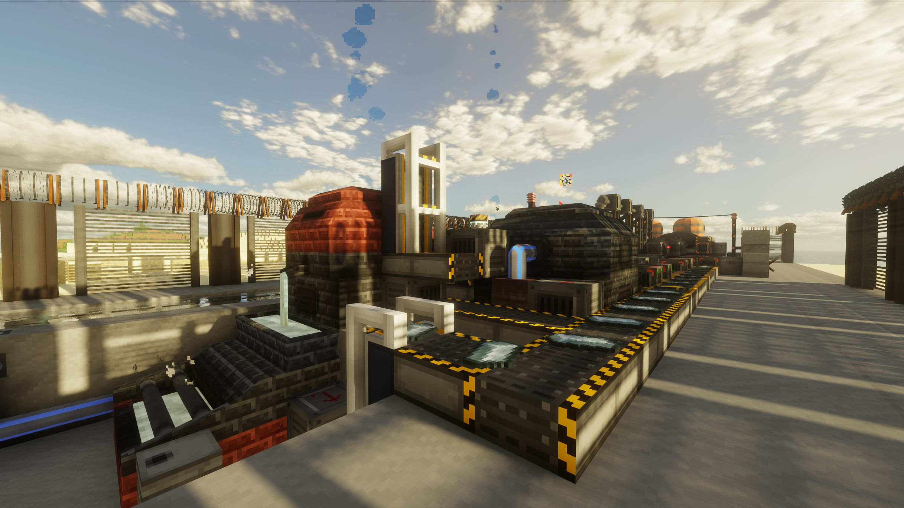
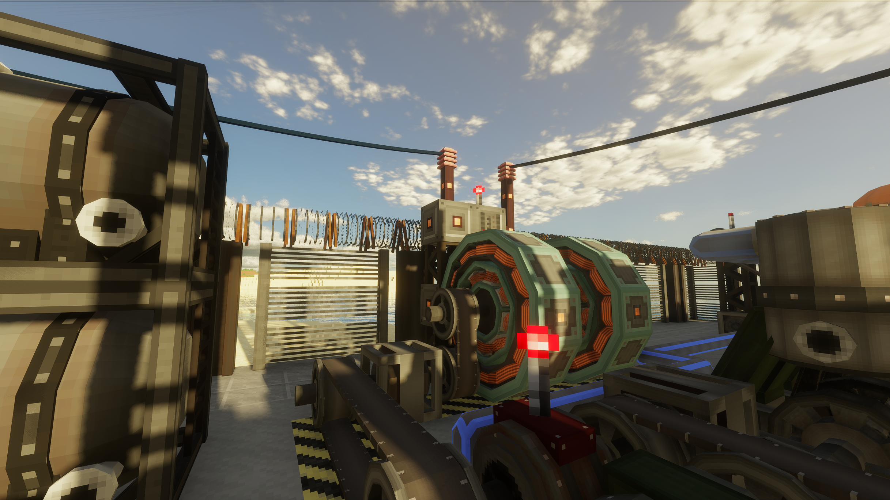
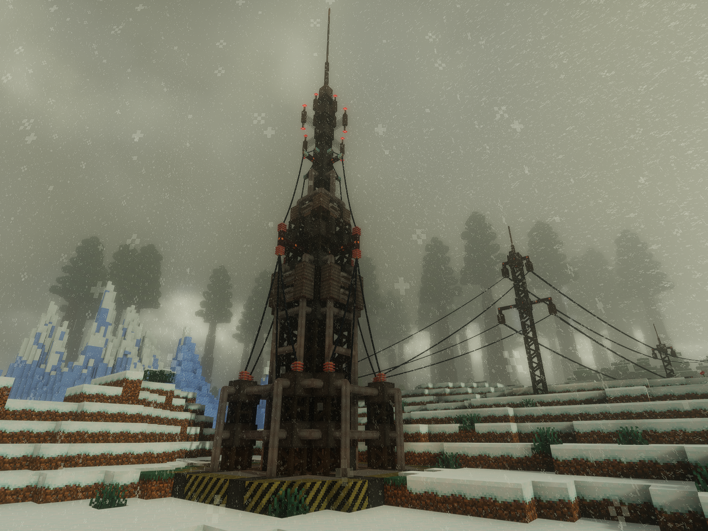
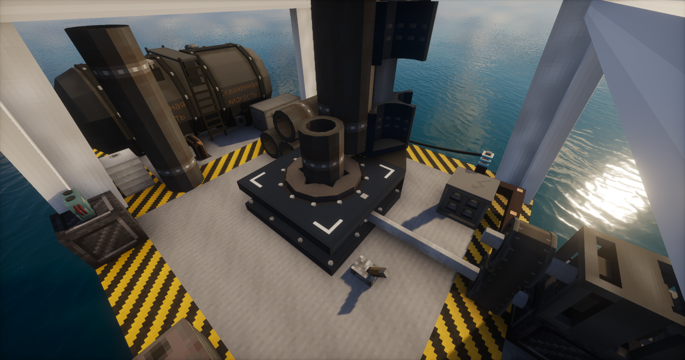

[US English](README.md) | **RU Русский**

# The Rift Division

**The Rift Division [TRD]** - это технический мод для Minecraft 1.21.1 (NeoForge).

⚠️ **Статус проекта:** Ранняя разработка (Pre-Alpha). В текущей версии представлены экспериментальные механики и заготовки. Многие функции могут быть нестабильны или отсутствовать. На данный момент наш мод НЕ опубликован на публичных площадках, таких как CurseForge и Modrinth в связи с статусом проекта.

---

## Концепция проекта

Наш мод совмещает в себе сразу две ключевые механики: техническое развитие и опасные экспедиции в новое измерение. Ранние этапы игры представляют из себя индустриализацию в чистом виде - игроки развивают свои технологии, строят базы и исследуют мир. Но ближе к началу мид-гейма (cередина прогрессии), игрок будет иметь достаточно ресурсов, чтобы начать геологические исследования глубин. Вскоре он обнаружит, что мир под бедроком (ниже высоты -64 по y) разделён на **4 слоя Некроза**. Каждый слой представляет из себя уникальную экосистему, совмещающую в себе ценные ресурсы и опасных обитателей, которые не очень рады гостям. 

Некроз представляет высокий интерес для игрока, как место сосредоточения множества полезных ископаемых, разных биологических материалов и нефти с уникальным составом, которое будто само напрашивается на пару демократических экспедиций =) Но есть одно но - ресурсы представлены в виде массивных залежей, добыча которых может занять игровые дни. Потребуется сборка специальных буров: модульные буровые установки со сменными головками, каркасами и вспомогательными модулями. Игроку придётся разбивать лагерь и строить фортификации вокруг своей буровой площадки, чтобы защитить её от нападений. Какое благо, что в нашем моде любезно представлены разные турели и оружие, которые облегчат оборону.

## Зависимости

**Требуется:** Minecraft 1.21.1 с NeoForge `21.1.244`

Для работы мода требуются следующие библиотеки:

*   **GeckoLib** `4.9.3` (1.21.1 NeoForge) - анимации существ, брони и инструментов.
*   **TerraBlender** `1.21.1-4.1.0.8` - генерация биомов.

**Панируется снести GeckoLib к чертям и заменить его на наш HEX Render в ближайшее время, с последующим ремейком всех ассетов что его использовали!**

**HEX рекомендует:**
*   **JEI (Just Enough Items)** `19.21.0.247` - для отображения рецептов.

**Встроено в мод (отдельно скачивать не нужно):**
*   **Flywheel** `1.0.6-44`
*   **HexRender** `2.0.0`

---

## Наши контакты:

*   **Discord:** *https://discord.gg/fnRfYfry7F* 

---

## Галерея
p.s. здесь продемонстрирован далеко не весь контент нашего проекта, просто КОМУ-ТО было немнооого лень.. все равно никто же не будет смотреть наш гитхаб, не так ли?

<table>
  <tr>
    <td align="center"></td>
    <td align="center"></td>
  </tr>
  <tr>
    <td align="center"></td>
    <td align="center"></td>
  </tr>
  <tr>
    <td align="center"></td>
    <td align="center"></td>
  </tr>
  <tr>
    <td align="center"></td>
    <td align="center"></td>
  </tr>
  <tr>
    <td align="center"></td>
    <td align="center"></td>
  </tr>
  <tr>
    <td align="center"></td>
    <td align="center"></td>
  </tr>
</table>

